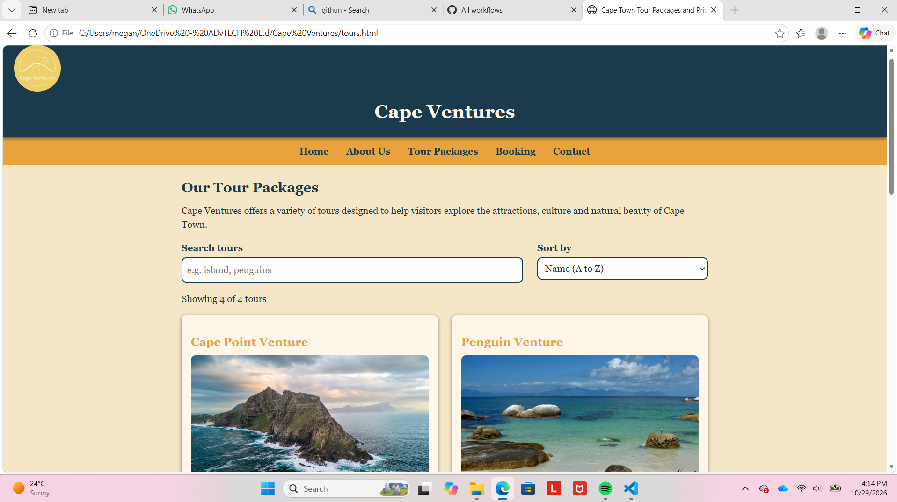
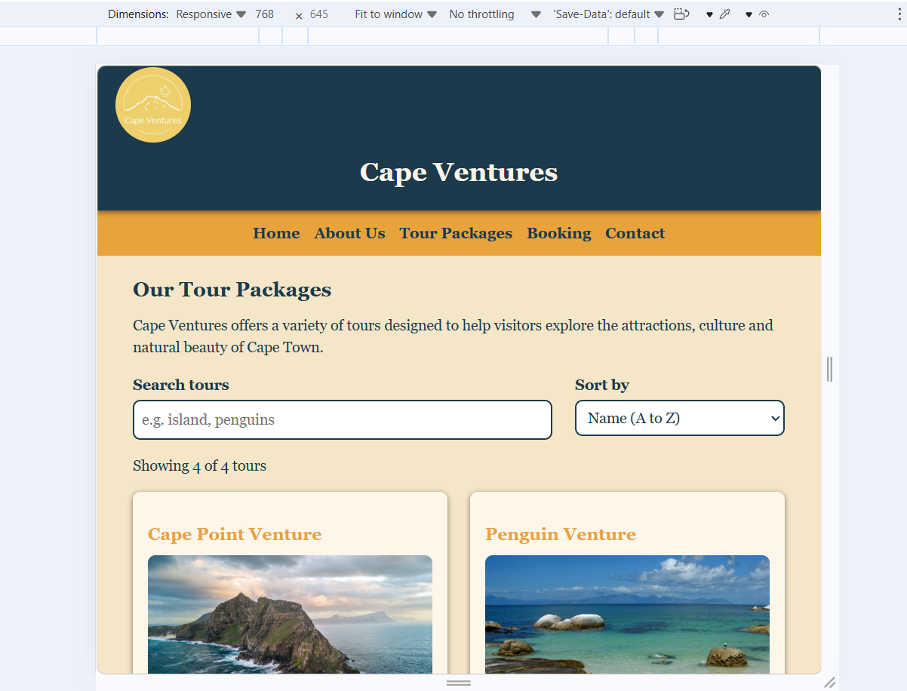
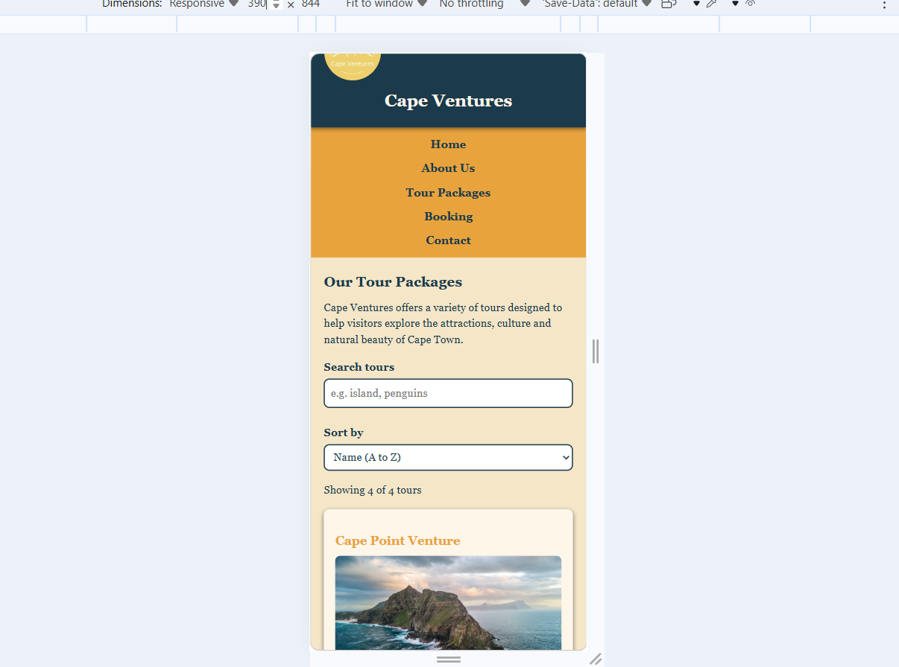

# Cape Ventures

## Student Information
- Name: Megan Arigundia
- Student Number: ST10518684
- Module: WEDE5020 (Web Development)

## Project Overview
Cape Ventures is a fictional tourism company that I created based in Cape Town, South Africa, established in 2022. This website was built as part of my Web Development Portfolio of Evidence to showcase the tour packages that the company offers and how they help tourists see more of Cape Town's top attractions.

## Website goals and Objectives
- Give visitors clear information about Cape Ventures and what they offer.
- Allow potential customers to enquire about tours and book tours through a contact form.
- Give customers a visually appealing website to use.
- Ensure the website works well on both laptops, tablets and mobile phones

## Key Features and Functionality
- Five linked pages: Home, Tours, About, Enquiry and Contact
- Custom Cape Ventures logo and a consistent navigation menu on every page
Flexbox hero section and CSS Grid Layouts for the tour, about and gallery cards
- Responsive design with tablet (900px) and mobile (600px) breakpoints that resize navigation, headings, text, grids and images
- Responsive images using srcset, with smaller 480px versions for small screens
- Interective elements: FAQ accordion, gallery lightbox, hover effects and scroll animations
- Dynamic tour cards built with JavaScript, with search and sort controls
- Interactive Leaflet map on the Contact page showing two Cape Town locations
- Enquiry form with validation, a itemised price quote, a 10% group discount for 6 or more travellers, and an availability check for Monday closures
- Contact form with validation that opens a pre-filled email to Cape Ventures

## Timeline and Milestones

| Part 1 | Planning, Structure and HTML          | 14/08/2026 | Completed                   |

| Part 2 | CSS styling and responsive design     | 18/09/2026 | Completed, Applied Feedback |

| Part 3 | JavaScript, SEO, forms and Deployment | 02/11/2026 | Completed, Applied Feedback |

## Sitemap
 The hierarchical Structure illustrates how the website pages will be structured

 Cape Ventures

 |
 Home Page (index.html)

 |
 About Us(about.html)| Tour Packages(tours.html)| Bookings(bookings.html)| Contact(contact.html)

 Table Mountain Venture| Cape Point Venture| Robben Island Venture| Penguin Venture

 ## Timeline and Milestones
 - Part 1: Project planning, HTML structure - completed
 - Part 2: CSS styling, responsive design- completed
 - Part 3: JavaScript functionality, SEO - in progress

 ## Part 1 Details
 This part involved researching on more information about the Cape Town tourism world, planning what I wanted the site structure to be like and building the basic HTML file structure

 ## Part 2 updates
 - Added 3 files I had not added in part 1 which are css,images and js
 - Downloaded the images I was going to use a visual representation of what the company offers
 - linked my css file to external stylsheet.css and linked it to all 5 pages
 - Added bas styles, typography, and an ocean/sand color scheme
 - Styled the navigation bar with flebox,hover,focus,active states
 - Added media queries for tablets and mobile phones
 - used rem units and percentage widths for responsive sizing
 - Added tour images and a custom logo
 - Made all images responsive
 - tested my website on a desktop and on a tablet and mobile phone

 ## Part 2 Feedback: What I Changed
 - No flexbox or grid used for content (Hero uses Flexbox; tour, about and gallery cards use CSS grid)
 - Responsive design only changed the nav and h1 (Tablet and mobile breakpoints now also resize h2,h3,body text, grids and images)
 - Box shadow typo ...space after rgba (Fixed the syntax and stored the shadow in a --shadow variable)
 - No :root variables (Added --navy, --gold, --sand, --cream, --white and --shadow)
 - No srcset on images (Added srcset to all images, with 480px versions made in Squoosh)
 - Imagess folder not included (Images folder is now committed to Github)
 - No screenshots (Added desktop, tablet and mobile screenshots.. see screenshots section)

## Part 3 Details

### Interactive elements
- **FAQ accordion** on the About page that opens and closes answers
- **Gallery lightbox** on the Tours page, using the dialog element with previous, next and close buttons
- **Hover effects and animations**: a fade-in on the page heading, card lift on hover, and scroll-reveal using IntersectionObserver

### Map
The Contact page has an interactive Leaflet map with two Cape Town locations (City Centre and V&A Waterfront). The buttons below the map fly to a location and open its popup.

### Dynamic content
The tour cards on the Tours page are built with JavaScript from an array of tour objects. Visitors can search by name and sort the tours. Robben Island is marked as closed on Mondays.

### Enquiry form
The form validates full name, email and phone number, and shows error messages. On submit it builds an itemised price quote, applies a 10% discount for 6 or more travellers, and checks whether the chosen date falls on a Monday when Robben Island is closed.

### SEO
- Unique title, description, keywords and author meta tags on every page
- Descriptive image file names and alt text
- Internal links in the footer and on the home page
- robots.txt and sitemap.xml
Local business structured data (JSON-LD) on the home page

### Off-page SEO plan
- Create a Google Business Profile for Cape Ventures
- Get listed on Tripadvisor and local Cape Town tourism directories
- Share tour photos on social media with links back to the site
- Ask past customers for review

### Page speed and security
- Page speed: images are compressed, smaller 480px versions load on small screens through srcset, and images below the top of the page use lazy loading.
- Security: a referrer policy meta tag is on every page, and the forms check input before using it.

## Screenshots

### Desktop

### Tablet

### Mobile

 ## Changelog
 - [10/08/2026]  - HTML structure for all 5 pages
 - [10/08/2026]  - Fixed viewport meta typo across multiple pages
 - [12/09/2026]  - Added CSS Stylesheet, base styles, colour scheme
 - [12/09/2026]  - Styled navigation menu with FleXbox and pseudo-classes
 - [15/09/2026]  - Added responsive breakpoints for different devices
 - [17/09/2026]  - Added images on the tour page, home page and a logo 
 - [17/09/2026]  - Made all images responsive 
 - [26/10/2026]  - Part 2 feedback: fixed the box-shadow typo and added :root variables
 - [26/10/2026]  - Part 2 feedback: Added FlexBox hero and Grid car layouts
 - [26/10/2026]  - Part 2 feedback: Extended media text, grids and images adapt
 - [26/10/2026]  - Part 2 feedback: Added srcset and 480px image copies
 - [26/10/2026]  - Part 3: Added FAQ accordion on the About page
 - [26/10/2026]  - Part 3: Added gallery with lightbox on the tours page
 - [26/10/2026]  - Part 3: Added leaflet map with two locations on the Contact page
 - [27/10/2026]  - Part 3: Added CSS animations and scroll reveal, and fixed a type that stopped the scroll animation from working
 - [27/10/2026]  - Part 3: Added dynamic tour cards with search and sort
 - [28/10/2026]  - Part 3: Added enquiry form with validation and price quote
 - [28/10/2026]  - Part 3: Added contact form with validation and email
 - [28/10/2026]  - Part 3: Added SEO titles meta descriptions, keywords, robots.txt and sitemap.xml
 - [28/10/2026]  - Part 3: Renamed images with descriptive file names for SEO
 - [28/10/2026]  - Part 3: Added internal links, local SEO data, referrer policy and lazy loading
 - [29/10/2026]  - Part 3: Fixed typos in forms, meta tags and CSS
 - [29/10/2026]  - Part 3: Deployed the website  
 - [29/10/2026]  - Part 2 feedback: Added s screenshot folder with more accurately measured views
              

 ## References

 Freepik (n.d.) *Historic prison tour Robben Island with view Table Mountain* [Online image]. Available at: https://www.freepik.com (Accessed: 16 September 2026)

 Oceans Around Us (2024) *Cape Point* [Online image]. Available at: https://oceansaroundus.com (Accessed: 16 September 2026)

  Tour Travel World (n.d.) *Table Mountain* [Online image]. Available at: https://www.tourtravelworld.com (Accessed: 16 September 2026)

  Tripadvisor (n.d.) *Cape Town* [Online image]. Available at: https://www.tripadvisor.com (Accessed: 16 September 2026)

  Arigundia, M. (2026) *Cape Ventures logo* [Own design, created using Canva]. Available at: https://canva.link/jjhjje8sq36vw7a (Accessed: 16 September 2026)

  Google Chrome Labs.  n.d. Squoosh. [Online]. Available at: https://squoosh.app [Accessed 20 October 2026].

  OpenStreetMap contributors. n.d OpenStreetMap copyright and license.[Online]. Available at: https://www.openStreetmap.org/copyright [Accessed 29 October 2026]

  Agafonkin, V. 2023. Leaflet: an open-source JavaScript library for interactive maps. [Online]. Available at: https://leafletjs.com [Accessed 23  October 2026].

 